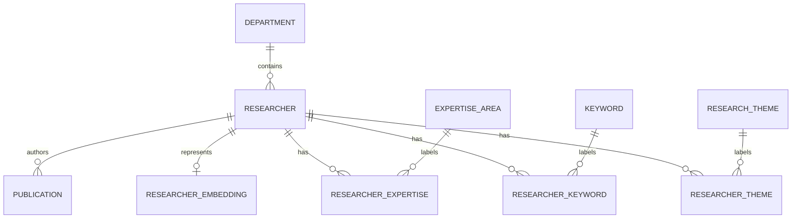

# Data model

Department, expertise, keyword and theme names are unique within their vocabularies. The three join tables use composite primary keys to prevent duplicate links, and reverse indexes support taxonomy-to-profile joins. Foreign keys maintain referential integrity. Publications belong to one researcher in this demo; introduce a publication-author join table for genuine co-authorship rather than copying publications.

`researcher` contains identity, biography, department and UTC timestamps. `search_document` is a derived text projection assembled from related records. Its generated English `tsvector` has a GIN index; canonical content remains normalised. Department and publication-year indexes support filtering and aggregate queries. Update the projection and embedding transactionally whenever related content changes.

`researcher_embedding` stores a 384-dimensional pgvector, model name, immutable model revision, SHA-256 content hash and generation timestamp. One active embedding per researcher keeps queries simple and makes model upgrades explicit. To evaluate multiple models concurrently, replace the single-profile uniqueness constraint with model/revision identity and add an index matching that access pattern. The existing compound constraint documents this eventual identity.

The dataset is tiny, so vectors use an exact distance scan. HNSW is not added merely to demonstrate an index: approximate retrieval needs recall and filtered-query benchmarks first. Keyword and relational access paths are indexed now.

Alembic revision `001` freezes explicit schema DDL independently of future ORM changes. The migration enables pgvector; the database role needs extension privileges at installation. Downgrade removes application tables but preserves the extension. Migration execution is a single-startup operation in this demo; multi-replica production rollout requires a dedicated migration job and least-privilege runtime role.

Seed IDs are deterministic. Seeding runs only against an empty researcher table and never replaces edited profiles. Sequences are advanced after explicit fixture IDs so future trusted inserts cannot collide. The application is read-only, and no destructive reset endpoint exists.
